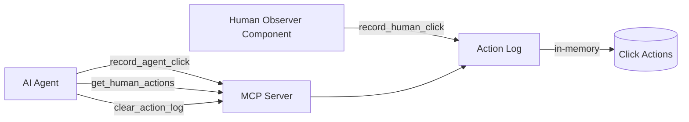

# Design Document

## Overview

The human action log system implements a lightweight MCP server that records click actions from both AI agents and human operators, normalizes coordinates across different coordinate systems, and detects patterns where human clicks follow agent clicks—suggesting the agent missed its target or failed to complete an action.

The system consists of three primary components:
1. **Action Log Store**: In-memory data structure holding normalized click actions
2. **MCP Server**: Exposes tools for recording agent clicks, querying human actions, and clearing the log
3. **Human Click Recorder**: Programmatic interface for external observer components to record human interventions

The design prioritizes simplicity and immediate feedback. All data lives in memory only, coordinate normalization happens at ingestion time, and mismatch detection runs on-demand during queries. The system makes no assumptions about which coordinate system callers use—screenshots, screen pixels, or device points—and normalizes everything to device points for consistent comparison.

### Key Design Decisions

**In-Memory Only**: No persistence layer, no database, no files. When the MCP server process terminates, the log disappears. This keeps deployment simple and avoids accumulating stale data across sessions.

**Normalization at Ingestion**: Raw coordinates arrive in various coordinate spaces (screenshot pixels, screen pixels, device points). The system converts all positions to device points immediately upon recording, storing both the normalized position and the original raw data with its scale factor. This allows accurate distance calculations for mismatch detection while preserving the original data for debugging.

**On-Demand Mismatch Detection**: Rather than maintaining a separate mismatch index, the system scans the action log when `get_human_actions` is called. For each human click, it looks backward through the previous 5 seconds of agent clicks and finds the closest one by Euclidean distance in normalized coordinates. This approach trades minimal CPU cost for implementation simplicity.

**Coordinate Scale Problem Detection**: When multiple mismatches show consistent offset ratios (within 10% variance), the system flags a systematic coordinate scaling issue. This helps agents distinguish between occasional targeting errors and a fundamental coordinate transformation bug.

**UI Element Redaction**: The system records only role (e.g., "button", "link") and a short label (max 50 characters) from UI elements. A redaction switch can suppress the label entirely, storing only the role. This prevents sensitive on-screen text from entering the log.

## Implementation Plan

### Phase 0: MCP SDK Verification

**Objective**: Build and run a minimal hello-world MCP server to verify the SDK API, import paths, and transport mechanisms before implementing any feature logic.

**Tasks**:
1. Install the MCP Python SDK: `pip install mcp`
2. Create a minimal server that exposes one hello-world tool
3. Do NOT assume import paths—consult the [official SDK documentation](https://github.com/modelcontextprotocol/python-sdk) for correct imports
4. Test with stdio transport using `mcp dev`
5. Test with Streamable HTTP transport using `mcp run`
6. Verify tool invocation works with MCP Inspector
7. Document the verified import paths and server initialization pattern for use in feature implementation

**Success Criteria**:
- Server starts without import errors
- Hello-world tool can be called successfully
- Both stdio and HTTP transports work
- Import paths and initialization pattern documented

**Example Minimal Server** (paths to be verified):
```python
# Placeholder - verify actual imports from SDK docs
# from mcp.server import MCPServer  # Hypothetical, check docs
# from mcp.transport import stdio, http  # Hypothetical, check docs

# @mcp.tool()
# def hello(name: str) -> str:
#     return f"Hello, {name}!"
```

This phase ensures we have working knowledge of the SDK before building the action log feature.

## Correctness Properties

This feature focuses on data recording, coordinate transformation, and pattern detection rather than business rules with universal invariants. The correctness properties are mathematical and algorithmic in nature, directly testable through the property-based tests defined in the Testing Strategy section.

### Property 1: Normalization Preserves Information

*For any* raw coordinates (x, y) with coordinate_space and scale_factor > 0, normalizing to device points and denormalizing should recover the original coordinates within floating-point precision.

**Validates: Requirements 1.1, 1.3, 1.4, 1.5**

### Property 2: One-to-One Human Click Matching

*For any* chronologically ordered list of click actions, each human click should match at most one agent click in the mismatch detection algorithm.

**Validates: Requirements 6.1, 6.2**

### Property 3: One-to-One Agent Click Matching

*For any* chronologically ordered list of click actions, each agent click should match at most one human click in the mismatch detection algorithm (bidirectional uniqueness).

**Validates: Requirements 6.1, 6.2**

### Property 4: Minimum Distance Matching

*For any* human click with multiple unmatched agent clicks in the 5-second window before it, the matched agent click should be the one with minimum Euclidean distance in device points.

**Validates: Requirements 6.2**

### Property 5: Scale Factor Recovery

*For any* list of agent clicks and known scale factor k, if human "corrections" are generated by dividing agent positions by k (agent = k * human), the scale problem detector should recover k within acceptable error when the relative spread criterion (≤10%) is satisfied.

**Validates: Requirements 7.1, 7.2, 7.3, 7.4**

### Property 6: Temporal Window Boundary

*For any* agent click and human click, if the time difference is ≥ 5.000 seconds, no mismatch should be created (exclusive boundary).

**Validates: Requirements 6.1**

### Property 7: Coordinate Space Independence

*For any* click target in device points, the normalized position should be invariant across different coordinate_space labels and corresponding scale_factors that represent the same physical location.

**Validates: Requirements 1.1, 1.4**

## Architecture

### System Context



The MCP server sits between AI agents (MCP clients like Claude, Cursor, or custom tools) and the in-memory action log. Agents call MCP tools over the Model Context Protocol (JSON-RPC 2.0 over stdio, HTTP, or SSE). The human observer component—which monitors UI automation frameworks like Playwright, Selenium, or iOS XCTest—calls the action log's public API directly to record human clicks.

### Technology Stack

**MCP Server Implementation**: Python 3.11+ using the official [Model Context Protocol Python SDK](https://github.com/modelcontextprotocol/python-sdk). The SDK provides decorators for tool registration, automatic JSON schema generation from type hints, request validation, and multi-transport support (stdio for local use, Streamable HTTP for deployment).

**Coordinate Systems**: The system recognizes three coordinate spaces:
- **device_points**: The iOS/macOS logical coordinate system (1 point = 1 pixel on non-retina, 1 point = 4 pixels on 2x retina, 1 point = 9 pixels on 3x retina)
- **screen_pixels**: Physical screen pixels
- **screenshot_pixels**: Pixels in a captured screenshot image, which may differ from screen pixels due to image scaling

All positions normalize to device points for storage and comparison. Callers provide a `scale_factor` to convert raw coordinates to device points: `device_x = raw_x / scale_factor`.

**Data Storage**: Python `list` for the chronological action log. No external database, no file I/O, no serialization. The log exists only while the MCP server process runs.

### Component Interaction Flow

**Agent Click Recording**:
1. Agent calls `record_agent_click` tool with raw x, y, coordinate_space, scale_factor, optional ui_element
2. MCP server receives JSON-RPC request, validates parameters
3. MCP server calls ActionLog.record_agent_click()
4. ActionLog normalizes coordinates: `device_x = raw_x / scale_factor`
5. ActionLog creates ClickAction object with timestamp (UTC ISO 8601), normalized position, raw coordinates, metadata
6. ActionLog appends ClickAction to in-memory list
7. MCP server returns success response to agent

**Human Click Recording**:
1. Human observer component (e.g., Swift macOS observer, browser JavaScript) detects human click event
2. Observer sends HTTP POST to `/human-click` endpoint with raw x, y, coordinate_space, scale_factor, optional ui_element
3. MCP server receives HTTP request, validates parameters
4. MCP server calls ActionLog.record_human_click()
5. ActionLog follows same normalization and storage flow as agent clicks (actor = "human")
6. MCP server returns JSON response with recorded timestamp

**Querying Human Actions with Mismatch Detection**:
1. Agent calls `get_human_actions` tool with optional `since_timestamp`
2. MCP server calls ActionLog.get_human_actions(since_timestamp)
3. ActionLog filters human clicks to those after the timestamp
4. For each human click, ActionLog scans backward 5 seconds (exclusive) for agent clicks
5. ActionLog finds closest agent click by Euclidean distance in device points
6. If found, ActionLog creates Mismatch object with offset vector (delta_x, delta_y)
7. ActionLog analyzes all mismatches for consistent offset ratios (within 10% variance)
8. If 3+ mismatches share ratio, ActionLog creates CoordinateScaleProblem report
9. MCP server serializes results (human clicks + mismatches + scale problem) to JSON
10. Agent receives structured response

## Components and Interfaces

### Action Log Store

**Purpose**: Core data structure holding all click actions with coordinate normalization and mismatch detection logic.

**Public Interface**:

```python
class ActionLog:
    def record_agent_click(
        self,
        x: float,
        y: float,
        coordinate_space: str,
        scale_factor: float,
        ui_element: Optional[UIElement] = None
    ) -> None:
        """Record an agent click action with coordinate normalization."""
        
    def record_human_click(
        self,
        x: float,
        y: float,
        coordinate_space: str,
        scale_factor: float,
        ui_element: Optional[UIElement] = None
    ) -> None:
        """Record a human click action with coordinate normalization."""
        
    def get_human_actions(
        self,
        since_timestamp: Optional[str] = None
    ) -> HumanActionsResponse:
        """
        Retrieve human actions after the given timestamp.
        Includes mismatch detection and coordinate scale problem analysis.
        Returns chronologically ordered actions (oldest first).
        
        Note: This is a pure function that processes the current state of the
        action log without side effects or time-dependent behavior.
        """
        
    def clear(self, before_timestamp: Optional[str] = None) -> int:
        """
        Remove actions before the given timestamp (exclusive).
        If no timestamp provided, clears all actions.
        Returns count of removed actions.
        """
```

**Internal Data Structures**:

```python
@dataclass
class UIElement:
    role: str  # "button", "link", "text_field", etc.
    label: Optional[str] = None  # Max 50 characters, None when redacted
    
@dataclass
class ClickAction:
    timestamp: str  # UTC ISO 8601 with milliseconds: "2026-05-15T14:30:45.123Z"
    actor: str  # "agent" or "human"
    normalized_x: float  # Device points
    normalized_y: float  # Device points
    raw_x: float  # Original coordinates
    raw_y: float  # Original coordinates
    coordinate_space: str  # "device_points", "screen_pixels", "screenshot_pixels"
    scale_factor: float  # Conversion ratio used for normalization
    ui_element: Optional[UIElement] = None
    
@dataclass
class Mismatch:
    agent_click: ClickAction
    human_click: ClickAction
    offset_x: float  # human_x - agent_x (device points)
    offset_y: float  # human_y - agent_y (device points)
    distance: float  # Euclidean distance (device points)
    
@dataclass
class CoordinateScaleProblem:
    sample_size: int  # Number of mismatches with valid scale samples
    scale_x: float  # Mean of agent_x / human_x ratios
    scale_y: float  # Mean of agent_y / human_y ratios
    spread_x: float  # Relative spread (std_dev / mean) in x dimension
    spread_y: float  # Relative spread (std_dev / mean) in y dimension
    
@dataclass
class HumanActionsResponse:
    human_actions: List[ClickAction]
    mismatches: List[Mismatch]
    coordinate_scale_problem: Optional[CoordinateScaleProblem] = None
```

**Coordinate Normalization Logic**:

The system converts raw coordinates to device points using the provided scale factor:

```
normalized_x = raw_x / scale_factor
normalized_y = raw_y / scale_factor
```

Example scenarios:
- **Already in device points**: scale_factor = 1.0
- **Screenshot at 2x retina**: If screenshot pixels map 1:1 to screen pixels on a 2x retina device, scale_factor = 2.0
- **Screenshot at 3x retina**: scale_factor = 3.0
- **Screenshot scaled down**: If a 1000x1000 screenshot represents a 500x500 device point region, scale_factor = 2.0

**Mismatch Detection Algorithm**:

For each human click H at time T_h:
1. Collect all agent clicks A where T_h - 5s < T_a < T_h (5 second window, exclusive bounds)
2. Filter out agent clicks already matched to an earlier human click (one-to-one matching)
3. If no unmatched agent clicks in window, no mismatch
4. If one unmatched agent click, create mismatch with that click
5. If multiple unmatched agent clicks, find closest by Euclidean distance in device points:
   - distance = sqrt((H.normalized_x - A.normalized_x)² + (H.normalized_y - A.normalized_y)²)
   - Select agent click with minimum distance
6. Create Mismatch object with offset vector:
   - offset_x = H.normalized_x - A.normalized_x
   - offset_y = H.normalized_y - A.normalized_y
7. Mark the matched agent click as used (cannot match to future human clicks)
8. No distance threshold—all matched pairs are flagged as mismatches regardless of offset magnitude

**Important**: Mismatch detection processes human clicks in chronological order, and each agent click can be matched to at most one human click. This ensures one-to-one correspondence between agent actions and human corrections.

**Coordinate Scale Problem Detection**:

After collecting all mismatches:
1. If fewer than 3 mismatches, no scale problem detected
2. Calculate scale ratios for each mismatch:
   - scale_x = agent_x / human_x (skip if human_x near zero, e.g., |human_x| < 1.0)
   - scale_y = agent_y / human_y (skip if human_y near zero, e.g., |human_y| < 1.0)
3. Compute mean and standard deviation of scale ratios across all valid samples
4. Calculate relative spread: spread_x = std_dev_x / mean_x, spread_y = std_dev_y / mean_y
5. If at least 3 valid samples exist AND relative spread ≤ 10% (0.10) in both dimensions, flag coordinate scale problem
6. Report average scale factors (mean scale_x, mean scale_y) and sample size

**UI Element Redaction**:

The ActionLog maintains a redaction flag (configurable at initialization or via environment variable):
- When redaction enabled: store UIElement with role only, label = None
- When redaction disabled: store UIElement with role and label (truncated to 50 characters)

### MCP Server

**Purpose**: Expose action log functionality to AI agents through the Model Context Protocol.

**Implementation Framework**: [MCP Python SDK v2](https://github.com/modelcontextprotocol/python-sdk)

**HTTP Server Configuration**:
- MCP protocol transport: stdio or Streamable HTTP
- Human click ingestion: Separate HTTP endpoint (`/human-click`) that binds to 127.0.0.1 by default
- Default port: 8000
- The MCP server process runs both the MCP protocol handler and the human click HTTP endpoint

**Tool Definitions**:

```python
from mcp.server import MCPServer

mcp = MCPServer("poltergeist-human-action-log")
action_log = ActionLog()

@mcp.tool()
def record_agent_click(
    x: float,
    y: float,
    coordinate_space: str,
    scale_factor: float,
    ui_element_role: Optional[str] = None,
    ui_element_label: Optional[str] = None
) -> dict:
    """
    Record an agent click action.
    
    Args:
        x: Raw x coordinate
        y: Raw y coordinate
        coordinate_space: One of "device_points", "screen_pixels", "screenshot_pixels"
        scale_factor: Conversion ratio to device points (e.g., 2.0 for 2x retina)
        ui_element_role: Optional UI element role (e.g., "button", "link")
        ui_element_label: Optional short label (max 50 chars)
        
    Returns:
        Success confirmation with recorded timestamp
    """
    ui_element = None
    if ui_element_role:
        ui_element = UIElement(role=ui_element_role, label=ui_element_label)
    
    action_log.record_agent_click(x, y, coordinate_space, scale_factor, ui_element)
    return {"status": "recorded", "actor": "agent"}

@mcp.tool()
def get_human_actions(since_timestamp: Optional[str] = None) -> dict:
    """
    Retrieve human click actions with mismatch detection.
    
    Args:
        since_timestamp: Optional UTC ISO 8601 timestamp (exclusive).
                        If omitted, returns all human actions.
                        
    Returns:
        Human actions, mismatches, and optional coordinate scale problem report.
        Actions are ordered chronologically (oldest first).
    """
    response = action_log.get_human_actions(since_timestamp)
    return {
        "human_actions": [asdict(a) for a in response.human_actions],
        "mismatches": [asdict(m) for m in response.mismatches],
        "coordinate_scale_problem": asdict(response.coordinate_scale_problem) 
            if response.coordinate_scale_problem else None
    }

@mcp.tool()
def clear_action_log(before_timestamp: Optional[str] = None) -> dict:
    """
    Clear action log entries.
    
    Args:
        before_timestamp: Optional UTC ISO 8601 timestamp (exclusive).
                         If omitted, clears all actions.
                         
    Returns:
        Count of removed actions.
    """
    count = action_log.clear(before_timestamp)
    return {"removed_count": count}
```

**Transport Configuration**:

The MCP server supports multiple transports:
- **stdio**: For local development and testing with MCP Inspector
- **Streamable HTTP**: For deployment where agents connect over HTTP

The human click HTTP endpoint always binds to 127.0.0.1 (localhost) by default for security, preventing external network access.

Example launch commands:
```bash
# Local development with stdio (MCP on stdio, human clicks on HTTP 127.0.0.1:8000)
mcp dev server.py

# Production deployment with HTTP (MCP on HTTP, human clicks on same host different endpoint)
mcp run server.py --transport streamable-http --host 127.0.0.1 --port 8000
```

**Error Handling**:

The MCP SDK automatically handles:
- JSON-RPC protocol errors
- Parameter validation (type checking from function signatures)
- Serialization/deserialization

The server adds:
- Validation of `coordinate_space` enum values
- Timestamp format validation (ISO 8601 with milliseconds)
- Scale factor validation (must be > 0)

Invalid requests return JSON-RPC error responses with descriptive messages.

### Human Click Recorder

**Purpose**: Provide an HTTP endpoint for external observer components running in separate processes to record human clicks.

**Implementation**: HTTP POST endpoint `/human-click` exposed by the MCP server, independent of the MCP protocol transport.

**Actor Attribution**: The system distinguishes agent clicks from human clicks by which channel they arrive on:
- Agent clicks arrive via MCP tool `record_agent_click` → actor = "agent"
- Human clicks arrive via HTTP POST to `/human-click` → actor = "human"

**HTTP Endpoint Specification**:

```
POST /human-click
Content-Type: application/json

{
  "x": 400.0,
  "y": 600.0,
  "coordinate_space": "screen_pixels",
  "scale_factor": 2.0,
  "ui_element": {
    "role": "button",
    "label": "Submit"
  }
}

Response 200 OK:
{
  "status": "recorded",
  "actor": "human",
  "timestamp": "2026-05-15T14:30:45.123Z"
}
```

**Usage Example**:

```python
# Swift macOS observer (using URLSession)
let payload = [
    "x": 400.0,
    "y": 600.0,
    "coordinate_space": "screen_pixels",
    "scale_factor": 2.0,
    "ui_element": [
        "role": "button",
        "label": "Submit"
    ]
]
let url = URL(string: "http://127.0.0.1:8000/human-click")!
var request = URLRequest(url: url)
request.httpMethod = "POST"
request.setValue("application/json", forHTTPHeaderField: "Content-Type")
request.httpBody = try! JSONSerialization.data(withJSONObject: payload)
URLSession.shared.dataTask(with: request).resume()
```

```javascript
// Browser JavaScript observer
fetch('http://127.0.0.1:8000/human-click', {
  method: 'POST',
  headers: { 'Content-Type': 'application/json' },
  body: JSON.stringify({
    x: 400.0,
    y: 600.0,
    coordinate_space: 'screen_pixels',
    scale_factor: 2.0,
    ui_element: {
      role: 'button',
      label: 'Submit'
    }
  })
});
```

**Integration Points**:

The HTTP endpoint integrates with observer components running in separate processes:
- **Swift macOS observer**: System-level click monitoring using Accessibility API or CGEvent tap
- **Browser JavaScript**: Injected script capturing click events via addEventListener
- **iOS XCTest runner**: Test framework hooks forwarding touch events
- **Playwright/Puppeteer**: Browser automation with click event listeners
- **Selenium**: WebDriver with JavaScript injection

Each integration sends HTTP POST requests to the human click endpoint with raw coordinates in its native coordinate space and the appropriate scale factor.

## Data Models

### Click Action Schema

Complete JSON schema for a ClickAction (as returned by `get_human_actions`):

```json
{
  "timestamp": "2026-05-15T14:30:45.123Z",
  "actor": "human",
  "normalized_x": 150.0,
  "normalized_y": 200.0,
  "raw_x": 300.0,
  "raw_y": 400.0,
  "coordinate_space": "screen_pixels",
  "scale_factor": 2.0,
  "ui_element": {
    "role": "button",
    "label": "Submit"
  }
}
```

### Mismatch Schema

```json
{
  "agent_click": { /* ClickAction */ },
  "human_click": { /* ClickAction */ },
  "offset_x": -10.5,
  "offset_y": 5.0,
  "distance": 11.64
}
```

### Coordinate Scale Problem Schema

```json
{
  "sample_size": 5,
  "scale_x": 2.03,
  "scale_y": 1.99,
  "spread_x": 0.049,
  "spread_y": 0.055
}
```

## Error Handling

### Validation Errors

**Invalid coordinate_space**:
- Error: "Invalid coordinate_space. Must be one of: device_points, screen_pixels, screenshot_pixels"
- HTTP Status: 400 (Bad Request) for HTTP transport
- JSON-RPC: -32602 (Invalid params)

**Invalid scale_factor**:
- Error: "scale_factor must be greater than 0"
- HTTP Status: 400
- JSON-RPC: -32602

**Invalid timestamp format**:
- Error: "timestamp must be UTC ISO 8601 with milliseconds (e.g., 2026-05-15T14:30:45.123Z)"
- HTTP Status: 400
- JSON-RPC: -32602

**UI element label too long**:
- Behavior: Truncate to 50 characters (no error)
- Log warning for debugging

### Runtime Errors

**MCP server crashes**: Action log lost (in-memory only). Clients receive connection errors and must reconnect to a fresh server instance.

**Timestamp parsing errors**: Return empty results rather than crashing (defensive programming).

**Division by zero in scale detection**: Skip mismatches with agent coordinates near zero when calculating ratios.

### Error Recovery

**Agent perspective**: 
- Failed `record_agent_click`: Retry once, then proceed (losing one action is acceptable)
- Failed `get_human_actions`: Retry with exponential backoff (human interventions are critical to discover)

**Server perspective**:
- Log all errors to stderr for debugging
- Continue serving other requests (isolated error handling per tool call)

## Testing Strategy

### Property-Based Testing with Hypothesis

The core algorithms (coordinate normalization, mismatch detection, scale problem detection) are implemented as pure functions that take action lists as input and produce deterministic output. This design enables comprehensive property-based testing.

**Testing Library**: [Hypothesis](https://hypothesis.readthedocs.io/) for Python

**Architectural Requirement for Testability**: 
- Mismatch detection and scale problem detection are implemented as pure functions: `detect_mismatches(actions: List[ClickAction]) -> Tuple[List[Mismatch], Optional[CoordinateScaleProblem]]`
- These functions never read the system clock—all timestamps come from ClickAction objects
- The ActionLog.get_human_actions() method is a thin wrapper that filters actions and delegates to the pure detection function

**Property Tests**:

**Property 1: Coordinate normalization round-trip**
- *For any* raw coordinates (x, y), coordinate_space, and scale_factor > 0, normalizing to device points and then denormalizing should recover the original coordinates within floating-point precision
- Generator: `@given(x=floats(min_value=-10000, max_value=10000), y=floats(min_value=-10000, max_value=10000), scale_factor=floats(min_value=0.1, max_value=10.0))`
- Assertion: `abs((normalized_x * scale_factor) - x) < 0.001 and abs((normalized_y * scale_factor) - y) < 0.001`
- **Validates: Requirement 1 (coordinate normalization)**

**Property 2: Each human click matches at most one agent click**
- *For any* chronologically ordered list of click actions, the mismatch detection algorithm should produce at most one mismatch per human click
- Generator: `@given(actions=lists(click_actions(), min_size=0, max_size=50))`
- Assertion: Count unique human clicks in mismatches ≤ count of human clicks in input
- **Validates: Requirement 6 (mismatch detection)**

**Property 3: Each agent click matches at most one human click**
- *For any* chronologically ordered list of click actions, the mismatch detection algorithm should produce at most one mismatch per agent click (one-to-one matching)
- Generator: `@given(actions=lists(click_actions(), min_size=0, max_size=50))`
- Assertion: Count unique agent clicks in mismatches ≤ count of agent clicks in input
- **Validates: Requirement 6 (one-to-one matching)**

**Property 4: Matched agent click is the minimum-distance candidate within the window**
- *For any* human click with multiple agent clicks in the 5-second window before it, the matched agent click should be the one with minimum Euclidean distance in device points
- Generator: Custom strategy that generates a human click and 2-5 agent clicks within 5 seconds before it
- Assertion: For each mismatch, verify no other unmatched agent click in the window is closer
- **Validates: Requirement 6 (closest match)**

**Property 5: Known scale factor recovery**
- *For any* list of agent clicks and scale factor k > 0, if we generate human "corrections" by dividing agent positions by k (agent = k * human), the scale problem detector should recover k within 1% error when the relative spread criterion is met
- Generator: `@given(agent_clicks=lists(click_actions(actor="agent"), min_size=3, max_size=10), scale_k=floats(min_value=1.5, max_value=3.0))`
- Setup: Generate human clicks at (agent_x / k, agent_y / k) with timestamps 2 seconds after each agent click
- Assertion: If scale problem flagged, `abs(detected_scale_x - k) / k < 0.01 and abs(detected_scale_y - k) / k < 0.01`
- **Validates: Requirement 7 (scale problem detection)**

**Property 6: Mismatch window boundary exclusivity**
- *For any* agent click and human click, if the time difference is exactly 5.000 seconds or greater, no mismatch should be created
- Generator: `@given(time_delta=floats(min_value=5.0, max_value=10.0))`
- Assertion: Mismatches list is empty when time_delta ≥ 5.0
- **Validates: Requirement 6 (5-second window, exclusive)**

**Property 7: Coordinate space independence**
- *For any* click action, the normalized device point position should be independent of which coordinate_space label is used, as long as the scale_factor correctly converts to device points
- Generator: `@given(device_x=floats(100, 1000), device_y=floats(100, 1000), scale=floats(1.0, 3.0))`
- Setup: Create two ClickActions with same device point target but different coordinate_space and corresponding raw coordinates
- Assertion: Both normalize to the same device point position
- **Validates: Requirement 1 (normalization correctness)**

**Custom Hypothesis Strategies**:

```python
from hypothesis import strategies as st
from datetime import datetime, timedelta

@st.composite
def click_actions(draw, actor=None):
    """Generate valid ClickAction objects with controlled timestamps."""
    base_time = datetime(2026, 5, 15, 14, 0, 0)
    offset_seconds = draw(st.floats(min_value=0, max_value=300))
    timestamp = (base_time + timedelta(seconds=offset_seconds)).isoformat() + "Z"
    
    actor_type = draw(st.sampled_from(["agent", "human"])) if actor is None else actor
    
    return ClickAction(
        timestamp=timestamp,
        actor=actor_type,
        normalized_x=draw(st.floats(min_value=0, max_value=1000)),
        normalized_y=draw(st.floats(min_value=0, max_value=1000)),
        raw_x=draw(st.floats(min_value=0, max_value=3000)),
        raw_y=draw(st.floats(min_value=0, max_value=3000)),
        coordinate_space=draw(st.sampled_from(["device_points", "screen_pixels", "screenshot_pixels"])),
        scale_factor=draw(st.floats(min_value=1.0, max_value=3.0)),
        ui_element=None
    )
```

**Test Configuration**:
- Minimum 100 iterations per property test (Hypothesis default)
- Deadline: 500ms per test case (adjust for CI environments)
- Shrinking enabled to find minimal failing examples

### Unit Tests

**Coordinate Normalization**:
- Example: Raw coordinates (400, 600) with scale_factor 2.0 normalize to (200, 300)
- Example: Raw coordinates (150, 200) with scale_factor 1.0 remain (150, 200)
- Example: Raw coordinates (900, 1350) with scale_factor 3.0 normalize to (300, 450)
- Edge case: scale_factor 0 raises validation error
- Edge case: Negative coordinates are preserved (allow negative offsets)

**Timestamp Generation**:
- Example: Verify timestamp format matches ISO 8601 with milliseconds
- Example: Verify timestamp is UTC (ends with 'Z')
- Example: Verify timestamps increase monotonically for sequential calls

**UI Element Redaction**:
- Example: With redaction disabled, store role and label
- Example: With redaction enabled, store role only (label = None)
- Example: Labels longer than 50 characters are truncated
- Edge case: Empty label is stored as empty string (not None) when redaction disabled

**Mismatch Detection**:
- Example: Agent click at (100, 100) followed 2 seconds later by human click at (110, 105) creates mismatch with offset (10, 5)
- Example: Agent click followed 6 seconds later by human click creates no mismatch (outside 5-second window)
- Example: Human click with no prior agent clicks creates no mismatch
- Example: Multiple agent clicks in window—closest by distance is matched, others remain unmatched
- Example: Agent click matched to first human click is not re-matched to second human click (one-to-one)
- Edge case: Agent and human clicks at identical positions create mismatch with zero offset
- Edge case: Human click at exact 5-second boundary (exclusive) creates no mismatch

**Coordinate Scale Problem Detection**:
- Example: 3 mismatches with scale ratios (agent_x/human_x, agent_y/human_y) of (2.0, 2.0), (2.05, 1.98), (1.98, 2.02) flag scale problem with scale_x ≈ 2.01, scale_y ≈ 2.00, relative spread < 10%
- Example: 3 mismatches with scale ratios (2.0, 2.0), (1.0, 1.0), (3.0, 3.0) do not flag scale problem (relative spread > 10%)
- Example: 2 mismatches do not trigger scale problem detection (need 3+)
- Edge case: Mismatches with human coordinates near zero (|x| < 1.0 or |y| < 1.0) are excluded from ratio calculation
- Edge case: If all mismatches have human coordinates near zero, no scale problem detected (insufficient samples)

**Action Log Clearing**:
- Example: clear(before_timestamp="2026-05-15T14:30:00.000Z") removes actions before that time, preserves actions after
- Example: clear() with no timestamp removes all actions, returns count
- Example: clear() on empty log returns 0

**Chronological Ordering**:
- Example: get_human_actions() returns actions oldest first
- Example: Actions recorded in order A, B, C are returned in order A, B, C
- Example: Filter by timestamp preserves chronological order

### Integration Tests

**MCP Server Tool Invocation**:
- Verify `record_agent_click` tool call stores action correctly
- Verify `get_human_actions` tool call returns expected JSON structure
- Verify `clear_action_log` tool call removes actions and returns count
- Test all three tools over stdio transport
- Test all three tools over Streamable HTTP transport

**HTTP Human Click Endpoint**:
- Verify POST to `/human-click` with valid payload records human action
- Verify response includes timestamp and actor="human"
- Verify invalid JSON returns 400 Bad Request
- Verify missing required fields returns 400 Bad Request
- Verify endpoint only binds to 127.0.0.1

**Full Workflow**:
1. Record agent click at (100, 100)
2. Wait 2 seconds
3. POST human click at (110, 105) to `/human-click`
4. Call get_human_actions
5. Verify response contains 1 human action, 1 mismatch with offset (10, 5)
6. Verify no coordinate scale problem (only 1 mismatch)

**Coordinate Scale Problem End-to-End**:
1. Record 5 agent clicks with systematic 2x offset error
2. POST 5 human corrections via `/human-click`
3. Call get_human_actions
4. Verify coordinate scale problem flagged with scale_x ≈ 2.0, scale_y ≈ 2.0, relative spread < 10%

**Error Handling**:
- Invalid coordinate_space returns JSON-RPC error -32602
- Invalid timestamp format returns error
- Zero scale_factor returns error

### Test Environment

**Test Framework**: pytest for unit, property-based, and integration tests

**MCP Testing Tools**:
- MCP Inspector for manual tool testing during development
- MCP SDK's test utilities for protocol-level testing

**Mock Objects**:
- Mock HTTP client for simulating human click POST requests
- Time-controlled ClickAction generators for deterministic timestamp testing (no system clock reads in core logic)

## Deployment

### Installation

```bash
# Install from local source
cd poltergeist
pip install -e .

# Or install from PyPI (once published)
pip install poltergeist-human-action-log
```

### Running the Server

**Local Development (stdio)**:
```bash
mcp dev poltergeist/server.py
```

**Production (HTTP)**:
```bash
# MCP on HTTP, human click endpoint on same host (both 127.0.0.1)
mcp run poltergeist/server.py --transport streamable-http --host 127.0.0.1 --port 8000
```

### Configuration

Environment variables:
- `POLTERGEIST_REDACT_UI_LABELS`: Set to "true" to enable UI element redaction (default: false)
- `POLTERGEIST_LOG_LEVEL`: Set logging level (default: INFO)

Example:
```bash
export POLTERGEIST_REDACT_UI_LABELS=true
mcp run poltergeist/server.py --transport streamable-http --host 127.0.0.1
```

### Client Integration

Agents connect to the MCP server using any MCP-compatible client. Example with the Python SDK:

```python
from mcp import Client

async with Client("http://localhost:8000/mcp") as client:
    # Record an agent click
    await client.call_tool("record_agent_click", {
        "x": 100.0,
        "y": 150.0,
        "coordinate_space": "device_points",
        "scale_factor": 1.0,
        "ui_element_role": "button",
        "ui_element_label": "Submit"
    })
    
    # Check for human interventions
    result = await client.call_tool("get_human_actions", {
        "since_timestamp": "2026-05-15T14:00:00.000Z"
    })
    print(result.structured_content)
```

### Monitoring

**Logging**: Server logs to stderr (JSON format for production parsing)
- INFO: Tool invocations with parameters
- WARNING: Validation failures, truncated labels
- ERROR: Runtime exceptions, connection failures

**Metrics** (future enhancement):
- Click action count (agent vs human)
- Mismatch rate
- Coordinate scale problem frequency
- MCP server request latency

### Security Considerations

**Authentication**: Not implemented in v1. Deploy the HTTP server behind a reverse proxy with authentication if needed.

**Authorization**: All MCP clients can access all tools. No per-client access control.

**Data Privacy**: 
- UI element labels limited to 50 characters to reduce sensitive data exposure
- Redaction mode available for high-sensitivity environments
- No persistent storage (data exists only in memory)
- HTTP endpoint binds to 127.0.0.1 by default, preventing external network access

**Input Validation**: All tool parameters validated by MCP SDK type checking plus custom enum/range validators.

## Future Enhancements

1. **Persistent Storage**: Optional SQLite backend for action log persistence across server restarts
2. **Time-Series Analysis**: Detect temporal patterns in human interventions (e.g., "human always corrects clicks to the left")
3. **Multiple Coordinate Systems**: Support additional spaces like web page coordinates, canvas coordinates
4. **Advanced Mismatch Heuristics**: Weight mismatches by UI element similarity, not just spatial proximity
5. **Real-Time Notifications**: WebSocket transport for push notifications when human actions occur
6. **Multi-Device Support**: Track clicks across multiple devices/browsers in parallel sessions
7. **Visualization Dashboard**: Web UI showing click heatmaps, mismatch patterns, timeline view
8. **Authentication**: OAuth2 or API key authentication for production deployments
